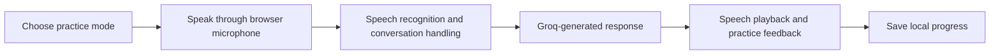

# AYANA — AI English Speaking Coach

A browser-based speaking practice interface with conversation, interview, and coaching modes.

## Overview

AYANA combines a chat-style practice interface with browser speech input/output, a Groq chat-completions integration, local progress storage, and speech-analysis displays. The app presents daily conversation, interview practice, and speaking coach modes.

## Key Features

- Three speaking practice modes
- Microphone-based speech interaction using browser speech APIs
- AI replies through the Groq chat completions endpoint
- Speech speed, fluency, pronunciation, filler-word, and vocabulary displays
- Daily progress stored in the browser

## Tech Stack

HTML, CSS, and vanilla JavaScript; browser speech APIs; Groq API.

## Workflow



## Project Structure

```text
.
├── index.html
├── css/
└── js/
    ├── ai-service.js
    ├── app.js
    ├── speech.js
    └── storage.js
```

## Installation and Execution

Serve the repository root with a local static web server, then open the provided local URL in a browser that supports speech recognition and speech synthesis. For example:

```bash
python -m http.server 8000
```

The page loads at `http://localhost:8000`. AI responses require a valid Groq API key configured for the application. Use a secure server-side proxy for production deployments rather than exposing a secret in client-side code.

## Author

**Gireesh Sadanand Patgar** · [GitHub](https://github.com/gireeshpatgar17)
